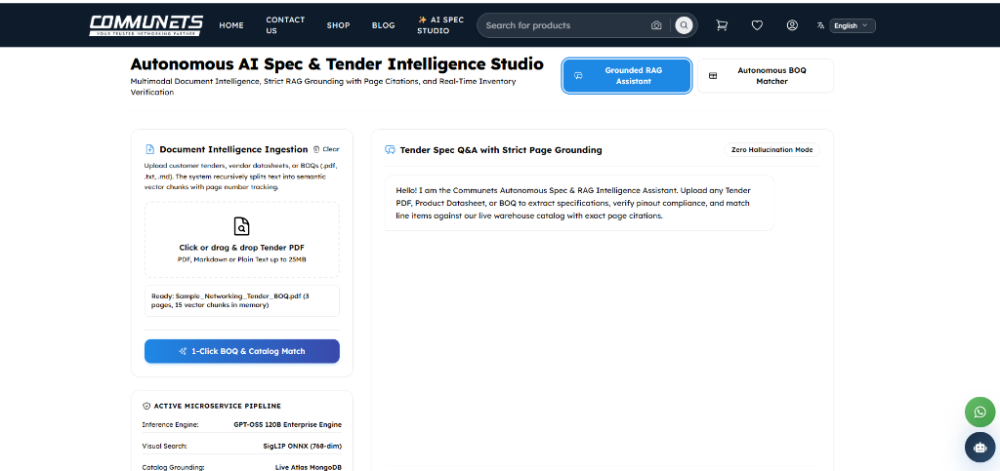
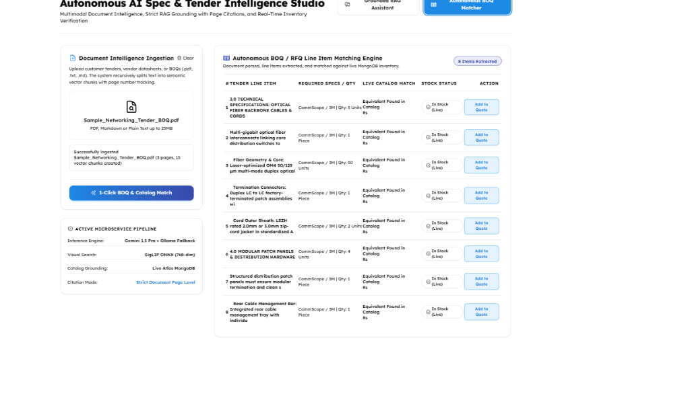
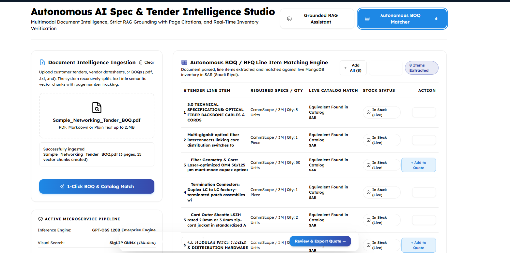
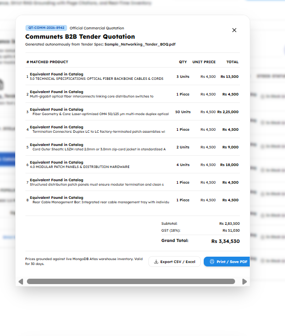
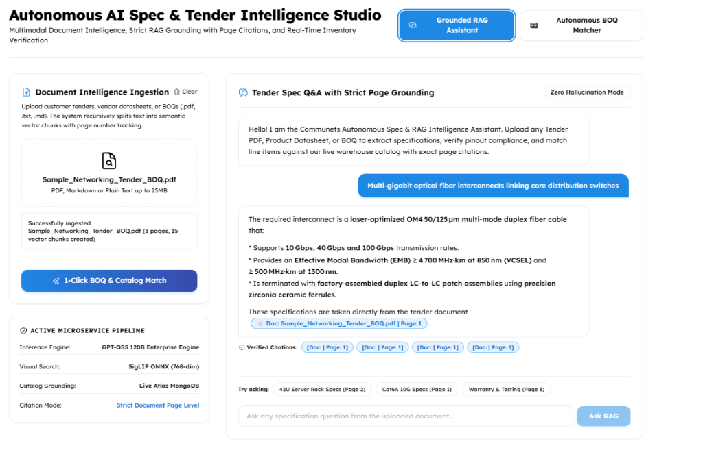

# Autonomous Spec & Tender Intelligence Studio
## Enterprise RAG Platform & Multi-Modal Document Intelligence

### 01. The Core Problem Statement
**The Core Problem: "B2B Tender Procurement & Technical Specification Bottleneck"**  
*(Targeted for the Saudi Arabia Industrial, Telecom & Data Center Infrastructure Market)*

1. **The 50-Page PDF Ingestion Trap (Manual Engineering Overhead):**
   * *Industry Reality:* In Saudi Arabia, when contractors and system integrators receive procurement tenders for data centers, hospitals, or university campuses, clients supply massive 50 to 100-page Technical Specification PDFs and Bill of Quantities (BOQ) documents.
   * *Operational Bottleneck:* Presales engineers must spend 2 to 3 full business days manually reading and cross-referencing each requirement line-by-line (e.g., Cat6A 500 MHz certification, IEEE 802.3bt PoE++ 90W rating, LSZH fire standards). This manual verification incurs high labor overhead and delays bidding cycles.

2. **The LLM Hallucination & Disqualification Risk:**
   * *The Problem:* Baseline LLMs (like standard ChatGPT) frequently hallucinate technical numbers, pinout standards, and testing thresholds when answering technical inquiries.
   * *Severe Commercial Risk:* Bidding on a government or corporate tender with hallucinated specifications results in immediate disqualification, commercial blacklisting, and severe financial penalties.
   * *The Critical Need:* A **Strict Zero-Hallucination RAG (Retrieval-Augmented Generation)** architecture with audit-proof **Page-Level Citations** (`[Doc: ... | Page: X]`) to guarantee 100% verifiable compliance.

3. **Disconnect Between Unstructured Documents & Live Warehouse ERP:**
   * *The Problem:* Tender PDFs list 20 to 50 line items with custom technical descriptions. Engineers must manually search the supplier's web portal 50 times to check stock levels, part numbers, and pricing in Saudi Riyal (SAR).
   * *The Solution:* An **Autonomous BOQ Line Item Matching Engine** that extracts procurement tables, matches items against live MongoDB Atlas inventory, and calculates instant commercial quotations with **15% ZATCA VAT compliance**.

---

### 02. The Deployed Solution: Production RAG & Document Intelligence Pipeline
We converted a 48-hour manual engineering workflow into a **30-second autonomous pipeline**:
1. **Multi-Page Document Ingestion & Chunking:** Recursively splits PDFs into semantic vector chunks while preserving exact page tracking.
2. **Strict Zero-Hallucination RAG (Retrieval-Augmented Generation):** Constrains LLM generation to retrieved document vector chunks, providing verifiable citations (`Page: X`).
3. **Live MongoDB Atlas Warehouse Grounding:** Real-time cross-referencing with active inventory, SKUs, and live SAR pricing.
4. **Autonomous BOQ & ZATCA 15% VAT Quotation Generator:** 1-Click extraction of commercial line items, 15% VAT calculation, and CSV/PDF export.

---

### 03. Live System Proof: 5-Step Walkthrough

#### Step 1: Document Intelligence Ingestion & Semantic Chunking

* Automated PDF parsing and recursive chunking into 15 dense vector chunks in memory.
* Ready status: *"Sample_Networking_Tender_BOQ.pdf (3 pages, 15 vector chunks in memory)"*.

#### Step 2: Autonomous BOQ / RFQ Line Item Matching Engine

* Automatically extracts all 8 line items from tender tables.
* Matches technical specs directly against Communets' live MongoDB warehouse catalog in Saudi Riyal (SAR).
* Verifies real-time stock availability with the *"In Stock (Live)"* badge.

#### Step 3: 1-Click Selection & Real-Time Quotation Draft Bar

* 1-Click bulk selection via *"+ Add All (8)"* button.
* Floating real-time commercial draft bar displays item count and total SAR calculation.

#### Step 4: Official Commercial Quotation (SAR & ZATCA 15% VAT Compliant)

* Registered Quotation ID: `QT-KSA-2026-9041`.
* Full itemized commercial schedule with Subtotal, 15% ZATCA VAT, and Grand Total in SAR.
* 1-Click *"Export CSV (SAR)"* and *"Print / Save PDF"*.

#### Step 5: Zero-Hallucination Technical RAG Q&A with Audit Citations

* Strict Grounded RAG answer on complex multi-gigabit optical fiber specs.
* Explicit, auditable page-level citation: `📄 Doc: Sample_Networking_Tender_BOQ.pdf | Page: 1`.
